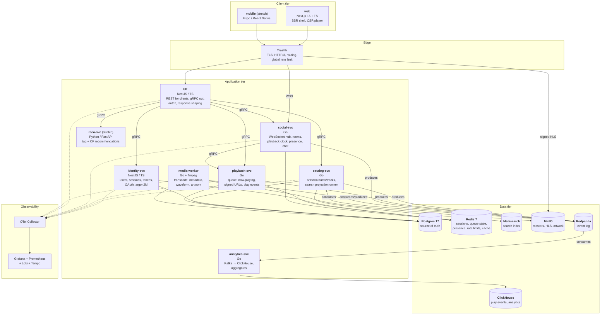

# Architecture — C4 Model

> These are the *starting point*. Redraw them yourself in Excalidraw or draw.io —
> the act of drawing is where the understanding happens. Keep the drawings in
> `docs/diagrams/`.

---

## Level 1 — System Context

```mermaid
graph TB
    Listener["Listener<br/><i>wants to discover music<br/>and listen with friends</i>"]
    Artist["Artist / Uploader<br/><i>wants to publish tracks<br/>and see who listens</i>"]
    Admin["Admin / Moderator<br/><i>reviews uploads,<br/>handles abuse</i>"]

    System["<b>Music Platform</b><br/><i>Streaming + synchronized<br/>social listening</i>"]

    Jamendo["Jamendo / FMA API<br/><i>Creative Commons catalog</i>"]
    Email["Transactional Email<br/><i>Resend / Postmark</i>"]
    OAuth["Google OAuth<br/><i>federated identity</i>"]
    CDN["Cloudflare<br/><i>edge cache, DDoS, HTTP/3</i>"]

    Listener -->|HTTPS, WSS| CDN
    Artist -->|HTTPS| CDN
    Admin -->|HTTPS via WireGuard| System
    CDN --> System
    System -->|imports catalog| Jamendo
    System -->|sends mail| Email
    System -->|delegates auth| OAuth
```

**Boundary note:** Admin plane is only reachable over WireGuard. It is never
exposed to the public internet. This is a deliberate networking lesson.

---

## Level 2 — Containers

---

## Service boundaries and why

| Service | Owns | Does NOT own | Language rationale |
|---|---|---|---|
| `bff` | Client-facing contract, response shaping, authz checks | Any business logic or data | TS — shares types with the frontend |
| `identity-svc` | Users, credentials, sessions, tokens | Profiles-as-content, social graph | TS — Nest's auth ecosystem is excellent |
| `catalog-svc` | Tracks, artists, albums, tags, search projection | Playback state, play counts | Go — read-heavy, high QPS |
| `playback-svc` | Queue, now-playing, signed media URLs | Catalog metadata, room state | Go — latency-sensitive, lots of Redis I/O |
| `social-svc` | Rooms, playback clock, presence, chat | Track metadata, user credentials | Go — tens of thousands of idle WS connections, goroutines are the right model |
| `media-worker` | Transcoding, derived media artifacts | Serving media | Go — ffmpeg orchestration + easy concurrency |
| `analytics-svc` | Event ingestion, aggregates | Any write path the user sees | Go — simple consumer |

### Rules we will not break

1. **One service owns each table.** No cross-service DB reads. Ever.
2. **Clients never talk to a service directly** except `social-svc` over WebSocket
   (because proxying WS through the BFF buys nothing and costs latency).
3. **Projections are built from the event log, not dual-writes.** Meilisearch and
   ClickHouse are downstream of Kafka. This is how you learn eventual consistency
   for real.
4. **Every inter-service call carries the trace context and the caller identity.**
   Internal mTLS in k3s, service tokens before that.
5. **Media bytes never pass through the application tier.** Clients get a signed
   URL and fetch from MinIO/CDN directly. Uploads go direct to MinIO with a
   presigned PUT.

### Deliberate "wrong" choices, documented

- **Single Postgres instance with a schema per service.** Logically separated,
  physically shared. Real microservices would have separate instances; on one
  server that's wasteful. We get the discipline without the cost. Documented in
  ADR-0005 as a known compromise.
- **No service mesh.** Istio/Linkerd on a single node is pure overhead. We get
  mTLS from k3s and tracing from OTel directly.
- **No API versioning initially.** Single client, we control both sides. We add
  `/v1` prefixes from day one so it's cheap later.

---

## Key sequence diagrams to draw yourself

Draw these in week 1. They're where the design flaws surface.

1. **Login + token refresh** — including the refresh-rotation race when two tabs
   refresh at once
2. **Upload → playable** — presigned PUT, `track.uploaded` event, worker, HLS
   output, `track.published`, search index update
3. **Play a track** — queue update, signed playlist request, hls.js segment
   fetches, `play.started` event
4. **Join a listening room** — WS connect, auth, clock sync handshake, state
   snapshot, buffer, coordinated start
5. **Host skips a track in a room** — command, server state version bump, fanout
   to N clients across M replicas, client reconciliation
6. **A client's network drops for 20s and recovers** — the one everybody gets wrong
